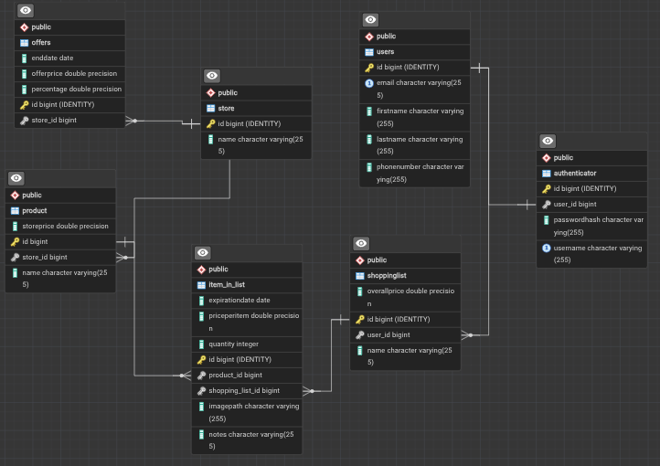
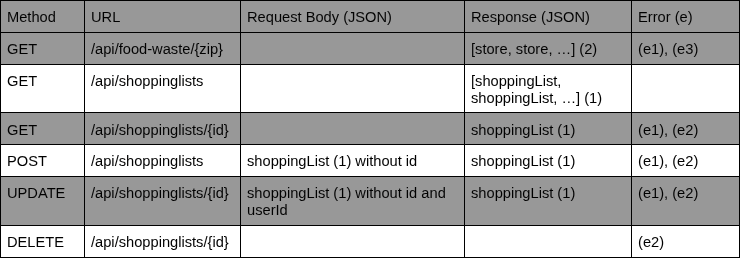

# Shopping list project

---
### vision 
The project is a shopping list for people who need a list, with the possibilities of giving discounted items, if the groceries are about to expire. 


I have build a system where you get salling group's listed items, that are about to expire, and making them visible,in the area you search for.

---

### Links 
Deployed application: http://157.245.47.198:8000/api

Source code repository: https://github.com/Szento/EK_exams_project

Portfolio website: https://szento.github.io/Blowfish/

---

### System overview

#### Structure
My project is layered into different folder depending on what they store. i have:

```
shopping_list
└── src
    └── main
        └── java
            └── app
                ├── api
                ├── config
                ├── controllers
                ├── dao
                ├── dto
                ├── entities
                ├── exceptions
                ├── routes
                ├── services
                ├── utils
                └── Main.java
```

| Package | Comment |
|---|---|
| `app/` | |
| `├── api/` |The api sends the key to salling in the Autherization and if we do not get a status 200, we get an APIException. It turn the JSON data inot DTO's after. |
| `├── config/` | The config package has hibernate, and entityManagerFactory, for storing entities inside the database. The ApplicationConfig creates the Javalin server and sets /api as its context path, registers the routes, sets up the JSON/date format and has exception handlers. the exception handler turns errors into 'status, msg'. Request logger logs every request to the API with its status code 200 and 404. |
| `├── controllers/` |Controllers include foodWasteController and ShoppingListController. The foodWasteController handles the endpoint where we get actual data from the salling API, if we give it a zip code, if not then we have validation, like 'zip must be 4 digits. <br><br> The shoppingListController calls DAO the DAO methods, reads the request validates it and calls the DAO, then returns JSON and a status code.    |
| `├── dao/` |The DAO's use the CRUD methods and lists them. I have added genericDAO and genericDAOImpl, to uphold the DRY principle |
| `├── dto/` |The DTO's add what we can get from the API, and ensures what can be exposed to a user, so any unsafe data stays hidden, if any. it reads the JSON data and makes us able to use the data to be shown to others. And then we have the ShoppingListDTO that returns a JSON value with name, overallPrice, userid and id.   |
| `├── entities/` |The entities are created into the database with the natural attributes the entity should have. It is dependent on what the application should be able to do.|
| `├── exceptions/` |The APIException holds a status code and a message. I use it in ApplicationConfig and APIReader, and it is thrown when a list isnt found 404, or if Salling failes, to give data 502.|
| `├── routes/` |The routes points to different endpoints, of the system, and when we go to the /api endpoint we get the following 'Shopping list API'. It uses the controllers to figure out what path we should be directed to.  |
| `├── services/` |The service only holds the sallinggroup API's and builds the endpoints, and passes it with the key to APIReade.  |
| `├── utils/` |The Utils is used to read all database connection values, and is being used in HibernateConfig. |
| `└── Main.java` |This is where we create our Javalin app, and where we find out where we can find the API keys. If it is being created locally we use our Config file and if via server, we use the environment key|

#### Technologies used:

* Java 
* Javalin
* JPA
* Hibernate
* PostgreSQL
* Maven
* Docker
* Github Actions
* Docker Hub + Watchtower
* DigitalOcean
* JUnit 5
* REST Assured
* Testcontainers
* Jackson 
* Lombok

---

### Data Model

#### ERD 

* offers 
* store 
* product
* item_in_list
* shoppinglist
* users 
* authenticator



#### Important Entities

All id's are created by the database with @GeneratedValue(strategy = GenerationType.IDENTITY).
PostgreSQL assigns the id when a row is inserted, and Hibernate writes the id back into the object. saved.getId() works right after save().

USER:  
A person using the application. The word user is reserved in PostgreSQL so i use users instead.

Fields:
 * id
 * firstName
 * lastName
 * email
 * phoneNumber

Relations:
 * One user has many shopping lists, @OneToMany
 * One user has one login, @OneToOne
 * cascade = CascadeType.ALL, if a user is deleted their lists and login are deleted as well


SHOPPINGLIST:  
A shopping list that a user has.

Fields:
 * id
 * name
 * overallPrice
 * user

Relations:
 * Many shopping lists belong to one user, @ManyToOne
 * One shopping list has many items, @OneToMany
 * cascade = CascadeType.ALL, if a shopping list is deleted its items are deleted as well


ITEMINLIST:  
One line on a shopping list. It connects a shopping list with a product, and holds extra information like quantity and price.

Fields:
 * id
 * quantity
 * pricePerItem
 * notes
 * imagePath
 * expirationDate
 * shoppingList
 * product

Relations:
 * Many items belong to one shopping list, @ManyToOne
 * Many items point to one product, @ManyToOne
 * The same product can only be on a list once, unique constraint on shopping_list_id + product_id (so it can change the quantity instead of keep expanding.)


PRODUCT:  
A product that is sold in a store.

Fields:
 * id
 * name
 * storePrice
 * store

Relations:
 * Many products belong to one store, @ManyToOne
 * A product can be on many shopping lists, through ItemInList


STORE:  
A store that sells products and has offers.

Fields:
 * id
 * name

Relations:
 * One store has many products, @OneToMany
 * One store has many offers, @OneToMany
 * cascade = CascadeType.ALL, if a store is deleted its offers are deleted as well


OFFERS:  
A discount in a store.

Fields:
 * id
 * offerPrice
 * percentage
 * endDate
 * store

Relations:
 * Many offers belong to one store, @ManyToOne


AUTHENTICATOR:  
The login information for a user. Planned for security, not used by any endpoint yet.

Fields:
 * id
 * username
 * passwordHash
 * user

Relations:
 * One login belongs to one user, @OneToOne


---

### REST API Documentation



#### Request Body and Response Formats
(1) ShoppingList format:
```
{
    "id": 1,
    "name": "Mealprep",
    "overallPrice": 50.0,
    "userId": 1
}
```
(2) Food waste store (one store, and one item):
```

[
  {
    "clearances": [
      {
        "offer": {
          "currency": "DKK",
          "discount": 1.95,
          "ean": "5712580445335",
          "endTime": "2026-10-30T22:59:59Z",
          "lastUpdate": "2026-10-29T13:25:27Z",
          "newPrice": 7.0,
          "originalPrice": 8.95,
          "percentDiscount": 21.79,
          "startTime": "2026-10-29T09:54:06Z",
          "stock": 1,
          "stockUnit": "each"
        },
        "product": {
          "categories": {
            "da": "Brød & kager>Lyst & groft brød>Boller",
            "en": "Bread And Cakes>Light Breads Dark Breads>Light Dark Buns"
          },
          "description": "KRYDDERBOLLER FK GAMLE MØLLE",
          "ean": "5712874603977",
          "image": "https://digitalassets.sallinggroup.com/image/upload/e_trim/c_limit,e_sharpen:80,f_auto,q_auto,w_400,h_400/6a8b83d064e56d95350d0f847b91e74d"
        }
      }
    ],
    "store": {
      "address": {
        "city": "Birkerød",
        "country": "DK",
        "extra": null,
        "street": "Teglporten 25",
        "zip": "3460"
      },
      "brand": "netto",
      "coordinates": [12.4318696, 55.8385755],
      "hours": [
        {
          "date": "2026-10-30",
          "type": "store",
          "open": "2026-10-30T07:00:00",
          "close": "2026-10-30T22:00:00",
          "closed": false
        }
      ],
      "name": "Netto Birkerød",
      "id": "04c0ea22-a54b-4f14-a10f-e16eb2d68d38",
      "distance_km": 0,
      "type": "Point"
    }
  }
]
```

#### Errors

(e) ALL errors use the same format: 
```
{ status : statusCode, "msg": "Explains the problem" }
```

(e1) 400 Bad Request: invalid input

```
{ "status": 400, "msg": "Zip code must be 4 digits" }
```
```
{ "status": 400, "msg": "name is required" }
```
```
{ "status": 400, "msg": "overallPrice cannot be negative" }
```
```
{ "status": 400, "msg": "user needs id" }
```
```
{ "status": 400, "msg": "TYPE_CONVERSION_FAILED" }
The id in the URL is not a number. 
```

(e2) 404 Not Found: the shopping list or user does not exist

```
{ "status": 404, "msg": "Shopping list with id 7 was not found" }
```
```
{ "status": 404, "msg": "User with id 999 not found" }
```

(e3) 502 Bad Gateway: the Salling API could not be reached

```
{ "status": 502, "msg": "Could not reach API: ..." }
```

---
### Use Case
```
Use Case 0
Name: Manage shopping lists
Primary actor: User
Reason: To create, view, rename and delete their shopping lists.
Main Success Scenario:
1. User creates a shopping list with a name
2. User sees all their shopping lists
3. User updates the name or price of a list
4. User deletes a list they no longer need

Use Case 1
Name: Add Item To a Shopping list
Primary actor: User 
Reason: To add an item you want to buy in your shopping list.
Main Success Scenario:
1. User chooses an item 
2. User sees item description
3. User adds item to list
Status: ItemInList entity exists, but there is no endpoint yet.

Use Case 2 
Name: Search for an item.
Primary actor: User 
Reason: To see what is the cheapest place to purchase the item.
Main Success Scenario:
1. User wants a specific item
2. User searches for item 
3. User gets the item they searched for from different stores
Status: Will be implemented with the catalog API

Use Case 3
Name: View Weekly Offers
Primary actor: User
Reason: To see current discounted products across stores so the user can plan purchases around active offers.
Status: Food waste shows current clearance offers per store, not weekly offers. 

Use Case 4
Name: Remove Item from Shopping List
Primary actor: User
Reason: To mark an item as purchased or delete it once no longer needed.
```